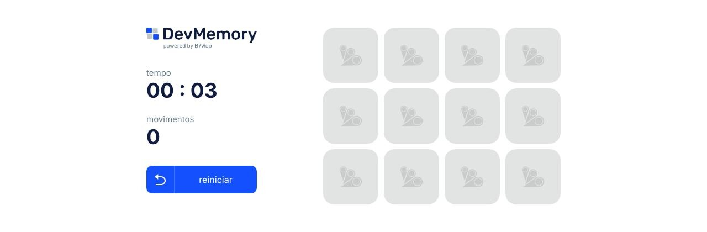

# react-memoria

[English](README.md)

Jogo da memória feito com React e TypeScript durante o estudo de hooks do React.

> **Tipo:** projeto de estudo (2023)



## Funcionalidades

- 12 cartas (6 pares) embaralhadas a cada novo jogo.
- Cartas iguais ficam viradas; se forem diferentes, voltam após um segundo.
- Tempo decorrido (mm:ss) e contador de movimentos.
- Botão "reiniciar"; o cronômetro para quando todos os pares são encontrados.
- Interface em português.

## Tecnologias

React 18, TypeScript 4.9, styled-components 6, Create React App (`react-scripts` 5).

## Como rodar

Requer Node.js (verificado com Node 22) e npm.

```bash
npm ci
npm start        # servidor de desenvolvimento em http://localhost:3000
npm run build    # build de produção em build/
```

## Estrutura

- `src/App.tsx`: estado do jogo (grade, tempo, movimentos) e lógica.
- `src/components/`: `Button`, `GridItem`, `InfoItem`.
- `src/data/items.tsx`: lista de ícones das cartas (`src/svgs/`).
- `src/helpers/formatTimeElapsed.tsx`: formatação do tempo.

## Limitações

- Sem testes automatizados (`npm test` não encontra arquivos de teste).
- Ferramental antigo do Create React App: o `npm audit` ainda aponta alertas altos/moderados em dependências de build e do servidor de desenvolvimento, sem correção compatível dentro do `react-scripts` 5. Eles não afetam o build estático gerado.

## Créditos

Baseado no exercício "DevMemory" de um curso da B7Web; o logo DevMemory ("powered by B7Web") e o ícone B7 vêm desse material. A origem dos ícones das cartas não está documentada.

## Segurança

Veja [SECURITY.md](SECURITY.md).

## Licença

Ainda não há licença definida; todos os direitos reservados ao autor.
